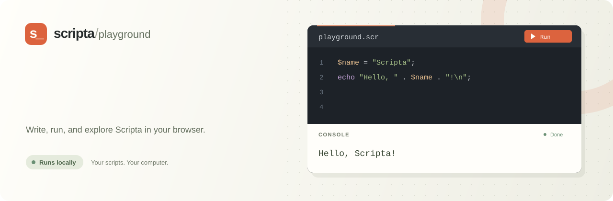

# Scripta Playground

A separate, optional local browser playground for
[Scripta](https://github.com/trafficinc/scripta), a scripting language.
See the Scripta repository for the interpreter, language documentation, and
interpreter build instructions. This project lives
outside the Scripta interpreter repository and Cargo workspace. Its editor,
server, dependencies, and downloads are not included in normal Scripta builds
or interpreter release archives.

## Download and launch

When standalone playground releases are available, use the Releases page of
this repository. To build from source instead, see [Build and check](#build-and-check-maintainers).

Use a playground archive matching your operating system and processor. Extract
it completely, then launch:

- macOS: double-click `Start Playground.command`.
- Windows: double-click `Start Playground.cmd`.
- Linux: run `./start-playground.sh` from the extracted folder.

The standalone download bundles Scripta under `runtime/`; users do not need Rust,
Python, Node, Docker, or a separate Scripta installation. The launcher opens the
browser automatically and prints a fallback URL. Quit from the page or press
Ctrl+C in the launcher terminal. Closing the browser tab alone leaves the server
running. Downloaded executables are unsigned; platform prompts may apply.

These are local launchers, not signed native app installers. Downloads must be
built and tested on each supported platform before being published.

## Use with an existing interpreter

Put `scr-playground` (`scr-playground.exe` on Windows) beside `scripta`, or add the
playground folder to PATH. With an interpreter containing the optional launcher:

```sh
scripta playground
scripta playground --no-open
```

The primary Scripta executable is `scripta`; the compatibility name `scr` is also
supported. This command launches the
separately installed companion and passes the current interpreter's absolute
path, so it uses your installed interpreter instead of the bundled copy.
It does not download or install anything automatically.

Alternatively set `SCR_PLAYGROUND_BIN` to the companion's full executable path.
You can run the companion directly with `scr-playground --scr /path/to/scripta`;
direct launch also searches `SCR_BIN`, the bundled runtime, adjacent executables,
and PATH, in that order, preferring `scripta` over `scr` in each directory.
Uninstall by deleting the extracted playground folder and
removing its PATH entry or environment override.

## What it does

The page provides a syntax-colored editor with line numbers, cursor position,
font sizing, an example sidebar, Run/Stop, separate output and error tabs, output
copying, a quick language guide, `.scr` import/download, and Ctrl/Cmd+Enter to run. Assets are built
into the executable and require no CDN or internet connection. Each run starts
a fresh interpreter in a temporary working directory with closed standard input.
Output appears after execution completes. Relative files are removed afterward;
absolute paths and host system access retain ordinary Scripta behavior.

Only trusted local scripts should be run. This is not a public execution service
or OS sandbox: scripts have your account's permissions and environment, including
filesystem, network, and process access. The server binds only to 127.0.0.1 on a
random port. Host and Origin validation and a random session token protect
execution requests from unrelated web pages. Do not proxy or expose it publicly.

Runs stop after 10 seconds, around 1 MiB of captured output, or the interpreter's
step/value/scope limits. Output is polled, so temporary files can exceed the
capture threshold between checks. Value limits are not a hard process-memory
ceiling. Stop terminates the interpreter's process group on Unix or Job Object
on Windows. Detached processes or subprocesses that create independent groups
can escape cleanup; this is another reason to run only trusted scripts.

## Build and check (maintainers)

Install a Rust toolchain supporting edition 2024, and build the `scripta` interpreter
from the [Scripta repository](https://github.com/trafficinc/scripta).
From the playground project directory:

```sh
cargo build --locked --release
SCR_TEST_BIN=/absolute/path/to/scripta cargo test --locked
python3 -m unittest discover -s tests -p 'test_*.py'
target/release/scr-playground --scr /absolute/path/to/scripta
python3 tests/http_smoke.py --binary target/release/scr-playground --scr /absolute/path/to/scripta
```

The execution tests require `SCR_TEST_BIN`; HTTP smoke additionally requires
permission to bind loopback sockets. `--no-open` keeps tests from opening a tab.

## Separate release packaging

First build and validate a normal Scripta interpreter archive with Scripta's
existing release procedure. Then build this project natively for the same target
and package it independently:

```sh
python3 scripts/package.py \
  --binary target/release/scr-playground \
  --runtime /path/to/scripta-0.1.1-aarch64-apple-darwin.tar.gz \
  --target aarch64-apple-darwin \
  --notices-dir /path/to/scripta/release-notices
```

Python is used only by maintainers for packaging and smoke tests. Packaging checks
the interpreter's inventory and hashes, preserves its complete notices/docs,
collects this app's dependency licenses, and writes a separate archive and SHA-256
sidecar under `dist/`. `--notices-dir` supplies reviewed upstream license
supplements when a locked crate omits them; provenance and hashes are checked.
Target dependencies must be available in Cargo's local cache before packaging.
The normal interpreter release process never includes this sibling project.

Publish this project in its own repository and publish its downloads separately.
No remote repository or public release is created by the local build scripts.

## License

This project is licensed under the [MIT License](LICENSE). Bundled interpreter
and dependency notices are included in standalone release archives.
